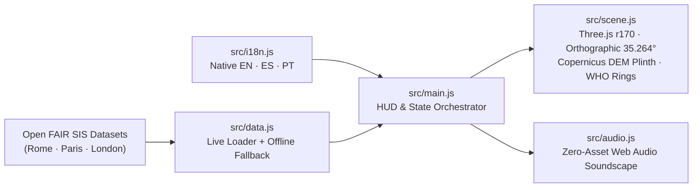

# 🌿 The Sensory Atlas — Modular 3D Contemplative Exploration Prototype

[](https://threejs.org/)
[](https://www.khronos.org/webgl/)
[](https://github.com/spacelabdevteam-hub/the-sensory-atlas-prototype/actions/workflows/ci.yml)
[](https://huggingface.co/spacejourney)
[](https://doi.org/10.5281/zenodo.22756473)
[](https://glama.ai/mcp/connectors/dev.workers.spacelab-mcp.space-journey-engine/space-journey)
[](LICENSE)
[](https://spacelabdevteam-hub.github.io/the-sensory-atlas-prototype/)

An open-source, zero-bundler **Three.js r170 ES Modules** isometric 3D spatial viewer developed by **[Space Lab](https://www.spacelab.network/)** for **[Space Journey](https://spacejourney.app/)** — the platform for contemplative tourism, acoustic wellbeing, and slow urban exploration.

Connected live to our open **FAIR Sensory Impact Score (SIS)** benchmarks across **Rome, Paris, and London**, this prototype translates real ambient sound pressure (`dB` vs. **WHO 53 dB Lden**), golden-hour solar windows, and **ESA Copernicus DEM GLO-90** satellite elevation into an interactive 3D Solarpunk sanctuary experience.

---

## 🧩 Modular Architecture



| Module | Responsibility |
| :--- | :--- |
| [`index.html`](./index.html) | Semantic entry point with Three.js `r170` native `importmap` and Open Graph metadata. |
| [`src/scene.js`](./src/scene.js) | True `35.264°` isometric `OrthographicCamera` (+ Perspective toggle), dynamic Copernicus DEM plinth relief, WHO 53 dB reference ring, solar lighting, and `prefers-reduced-motion`. |
| [`src/data.js`](./src/data.js) | Live loader + schema normalizer for Rome (`01_rome`), Paris (`02_paris`), and London (`03_london`) FAIR JSON benchmarks with verified offline fallback. |
| [`src/audio.js`](./src/audio.js) | Optional zero-asset procedural Web Audio API soundscape (muted by default) calibrated to each sanctuary's acoustic `dB` floor. |
| [`src/i18n.js`](./src/i18n.js) | Native multilingual interface (`EN`, `ES`, `PT`) with localized Space Journey links. |
| [`src/styles.css`](./src/styles.css) | Solarpunk glassmorphism HUD (`#061212`, `#10B981`, `#E8C57D`) with Photonic Silhouette Materialization and responsive `< 900px` layout. |
| [`tests/verify_prototype.mjs`](./tests/verify_prototype.mjs) | Automated zero-dependency Node.js test suite executed in GitHub Actions CI. |

---

## 🧭 Live Interactive Experiences

Explore the production Space Journey ecosystem:

* **[Live GitHub Pages Prototype](https://spacelabdevteam-hub.github.io/the-sensory-atlas-prototype/)** — Modular Three.js `r170` viewer consuming Rome, Paris & London FAIR datasets in real time.
* **[Live 3D Sensory Atlas (Rome Pilot)](https://spacejourney.app/play/roma-atlas/)** — Full interactive isometric playable exploring acoustic refuges in Rome.
* **[Roman Forum Viewer](https://spacejourney.app/play/foro-romano/)** — Spatial reconstruction prototype with real-time camera controls.
* **[Sensory Earth (3D Audio & Atmosphere Globe)](https://spacejourney.app/earth/)** — Interactive global soundscape portal across 227 territories.
* **[Sensory Itinerary Planner](https://spacejourney.app/en/itinerary-planner/)** — Human-paced itinerary builder balancing culture and calm *(also in [Español](https://spacejourney.app/planificador-de-viajes/) & [Português](https://spacejourney.app/pt-br/planejador-de-viagens/))*.
* **[AI Journey Assistant & Sensory Copilot](https://spacejourney.app/en/ai-journey-assistant/)** — Conversational AI guide for unhurried routes *(also in [Español](https://spacejourney.app/ai-journey-assistant/) & [Português](https://spacejourney.app/pt-br/ai-journey-assistant/))*.
* **[Space Journey Trip Saver Extension](https://spacejourney.app/en/travel-extension-chrome-safari/)** — Organize stays, experiences, and maps without 40-tab fatigue *(also in [Español](https://spacejourney.app/extension-viajes-chrome-safari/) & [Português](https://spacejourney.app/pt-br/extensao-de-viagem-chrome-safari/))*.

---

## 📊 Open FAIR Sensory Telemetry (GitHub, Hugging Face & Zenodo)

All acoustic, luminous, and topographic metrics rendered in this viewer are open-access under **CC BY 4.0** and archived via **CERN Zenodo** ([DOI: `10.5281/zenodo.22756473`](https://doi.org/10.5281/zenodo.22756473)):

* **Unified GitHub Benchmark Repo:** [spacelabdevteam-hub/sensory-impact-score-datasets](https://github.com/spacelabdevteam-hub/sensory-impact-score-datasets)
* **Rome Benchmark:** [spacejourney/rome-sensory-impact-dataset](https://huggingface.co/datasets/spacejourney/rome-sensory-impact-dataset)
* **Paris Benchmark:** [spacejourney/paris-sensory-impact-dataset](https://huggingface.co/datasets/spacejourney/paris-sensory-impact-dataset)
* **London Benchmark:** [spacejourney/london-sensory-impact-dataset](https://huggingface.co/datasets/spacejourney/london-sensory-impact-dataset)
* **Global 6-Capital Benchmark (94 Sanctuaries):** [spacejourney/global-sensory-impact-benchmark](https://huggingface.co/datasets/spacejourney/global-sensory-impact-benchmark)

```python
from datasets import load_dataset

dataset = load_dataset(
    "spacejourney/london-sensory-impact-dataset",
    data_files="data/london_sensory_impact_sis_v1.csv",
)
print(dataset["train"][0])
```

---

## 🤖 Space Lab Ecosystem & MCP Infrastructure

* **[Glama Verified MCP Connector](https://glama.ai/mcp/connectors/dev.workers.spacelab-mcp.space-journey-engine/space-journey)** — Remote Model Context Protocol endpoint (`space-journey-mcp-engine`).
* **[Space Lab Network](https://www.spacelab.network/)** — Open spatial computing, SaaS systems & conversational travel architecture.
* **[Concierge AI Hub](https://concierge.spacelab.network/concierge-ai-hub)** — Multilingual conversational hospitality demos ([EN](https://concierge.spacelab.network/general-concierge-english) · [ES](https://concierge.spacelab.network/general-concierge-es) · [PT](https://concierge.spacelab.network/general-concierge-portugues)).

---

## 🛠️ Tech Stack & Design Tokens

* **Rendering Engine:** Three.js `r170` (native browser ES Modules via `importmap`, WebGL 2.0, zero build step).
* **Camera System:** True isometric `OrthographicCamera` (elevation `35.264°`, azimuth `45°`) with live Perspective toggle.
* **Solarpunk Color System:** Deep Space Obsidian `#061212`, Solarpunk Emerald `#10B981`, Noble Gold `#E8C57D`.
* **Audio Engine:** Zero-asset Web Audio API procedural soundscape (muted by default, responsive to sanctuary `dB`).
* **Accessibility:** Strict `prefers-reduced-motion` degradation, keyboard navigation (`←`/`→`), and native `EN / ES / PT` UI.

---

## 🚀 Quick Start & Automated Testing

```bash
# 1. Clone the repository
git clone https://github.com/spacelabdevteam-hub/the-sensory-atlas-prototype.git
cd the-sensory-atlas-prototype

# 2. Run the automated verification suite (Node.js 20+, zero dependencies)
npm test

# 3. Serve locally (ES Modules require an HTTP server)
python -m http.server 8000
# Open http://localhost:8000
```

---

## 📄 License & Contributions

Distributed under the **MIT License**. See [`LICENSE`](./LICENSE) and [`CONTRIBUTING.md`](./CONTRIBUTING.md) for details.
